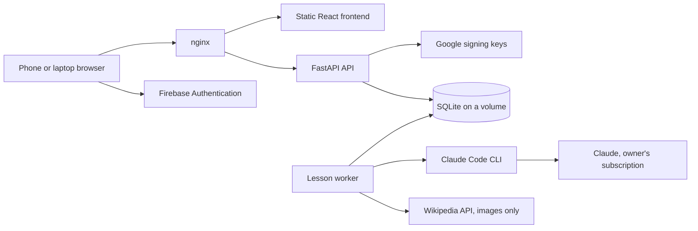

# Ataraxia architecture and data

A React frontend and a FastAPI backend served through nginx, with a separate worker
process that prepares lessons by calling the Claude Code CLI. Data lives in one SQLite
database on a Docker volume. Everything runs under Docker Compose on one host; the
owner's laptop needs only Docker.

The application serves one owner. Horizontal scaling, multiple users, and
distributed work queues are out of scope.

## Technical decisions

| Concern | Decision | Reason and boundary |
| --- | --- | --- |
| Frontend | React, TypeScript, Vite, React Router (declarative) | A small client app with no need for server rendering. |
| UI | CSS modules, shared CSS tokens, self-hosted fonts | Consistent themes and layouts without a component framework or third-party font requests. |
| Lesson rendering | react-markdown with GFM and KaTeX; no raw HTML | Headings, lists, tables, code, and formulas while keeping model output inert. |
| Remote state | TanStack Query | Fetching, invalidation, polling while a lesson is being prepared. |
| Backend | FastAPI, Pydantic, typed Python | Explicit request/response contracts over small application services. |
| Storage | SQLite (WAL mode) on a named volume | One file, real queries over the activity record, simple backups. See below. |
| Background work | One sequential worker process | Lesson preparation takes a minute or more and must not run in API requests. |
| Generation | Claude Code CLI in print mode, owner's subscription | The owner's requirement; tools disabled so it is a text-in, text-out call. |
| Authentication | Firebase email/password; API verifies ID tokens and one owner UID | The owner creates the account manually; sign-up is disabled. |
| Edge | nginx on one origin | Routes frontend and API; TLS comes from the deployment's private network. |
| Tooling | uv, npm lockfile, pytest, Ruff, mypy, Vitest, Testing Library | Pinned versions, behavior-focused checks. |

### Why SQLite instead of Redis

The original design used Redis as the database because it was the requested
starting point. Nothing had been stored in it yet when the product turned to lessons.
The new product's most important data, the activity record, is something to query
("minutes read per subject last month", "which liked lessons were never finished"),
which SQL does directly and Redis would need hand-built indexes for. SQLite also
removes a service, and a backup is one consistent file copy. Two processes (API and
worker) share the file on the same host's volume with WAL mode and a busy timeout;
that is well within SQLite's supported use.

## Runtime shape



Only nginx publishes a port, bound to loopback by default. The API and worker share
the backend image's code but run as separate containers; only the worker image
contains the Claude CLI and only the worker mounts the Claude login volume. The API,
which handles network requests, therefore never holds the Claude credential.

The worker runs as an unprivileged user. Its only outbound calls are Claude (through
the CLI) and Wikipedia's API for image lookups. The CLI runs with all tools, MCP
servers, and project settings disabled, from an empty working directory, with the
prompt on standard input; see [Lessons](lessons.md#calling-claude).

## Code organization

```text
backend/src/ataraxia/
  domain/        # Subjects, lesson content rules, streaks and statistics, subject choice
  application/   # Use cases and the protocols they depend on
  adapters/      # SQLite repositories, Firebase verifier, Claude CLI, Wikipedia, fakes
  api/           # Routes, request/response models, auth dependency
  worker/        # Loop, scheduling, health
  tools/         # Command-line tools (export, stats)
  bootstrap.py   # Builds concrete implementations from settings
frontend/src/
  app/           # Routing, providers, shell, tokens
  features/      # today, lesson, library, progress, settings, auth
  components/    # Shared visual components
  lib/           # API client, auth client, formatting
```

Dependencies point inward: API, worker, and adapters depend on application and domain
code; domain code imports no FastAPI, SQLite, Firebase, or subprocess code.
Application services take their dependencies in constructors; `bootstrap.py` is the
only place that chooses implementations.

Protocols exist where behavior crosses a boundary:

| Protocol | Responsibility | Implementations |
| --- | --- | --- |
| `IdentityVerifier` | Turn a bearer token into a verified UID | Firebase (Google keys); fixed local owner for development |
| `LessonGenerator` | Turn a lesson brief into validated lesson content and usage | Claude CLI; deterministic fake |
| `IllustrationResolver` | Turn Wikipedia titles into image URLs and page links | Wikipedia Action API; fake |
| `Clock` | Current UTC time | System; fixed in tests |

Repositories are concrete SQLite classes with narrow methods per use case; tests run
them against a temporary database file, which is fast and needs no service.

## Data

Every table is created by numbered migrations tracked with `PRAGMA user_version`.
The application refuses to start on a database newer than it understands. Dates are
`YYYY-MM-DD` strings in the owner's time zone; timestamps are UTC ISO 8601. IDs are
UUIDs. There is no owner column: the database belongs to the one owner.

| Table | Purpose and essential fields |
| --- | --- |
| `profile` | Single row: time zone, enabled subjects, lesson length, morning lesson on/off and hour, timestamps |
| `lessons` | Immutable content: ID, created time, local date, subject, origin (daily, surprise, subject, topic, follow-up), request text, parent and thread root IDs, title, hook, reading minutes, Markdown body, structured extras (key ideas, glossary, go-deeper, further, tags), illustrations, model, prompt version |
| `lesson_state` | Mutable per lesson: saved (and when), rating −1/0/1 (and when), first opened, finished, total reading seconds, furthest scroll, flagged note |
| `generation_jobs` | Requested work: kind, local date, subject, topic or question, parent lesson, status (queued, running, succeeded, failed), attempts, error code, resulting lesson, timestamps. One daily job per date (unique index). |
| `generation_calls` | One row per Claude call, inserted before the call: job, local date, duration, outcome, model, reported tokens and cost. Today's rows, minus calls refused for login or usage limits, enforce the daily cap. |
| `reading_sessions` | One row per reader visit: lesson, client session ID, start time, local date, cumulative seconds, furthest scroll; upserted by periodic reports |
| `activity_events` | Append-only: sequence ID, UTC time, local date, type, lesson ID, subject, small JSON payload |
| `worker_status` | Single row: last heartbeat, last error code, Claude login expiry, so the API can say whether lessons can be prepared |

Lesson content never changes after it is stored; saving, rating, reading, and
finishing change `lesson_state` and append events. Publishing a prepared lesson
(lesson row, state row, job update, event) is one transaction. Export includes every
table except internal worker status.

## API outline

All application routes are under `/api/v1` and require the owner's identity, except
the public client configuration. `/api/health/live` and `/api/health/ready` are public
and return only a status. `GET` requests never start lesson preparation.

| Endpoint | Behavior |
| --- | --- |
| `GET /api/v1/client-config` | Public: auth mode and Firebase web configuration (public by design) |
| `GET/PATCH /me` | Read or update settings; validates time zone, subjects, length, hour |
| `GET /today` | Local date, today's daily lesson or its job, unfinished lessons, active jobs, remaining allowance, worker availability |
| `POST /today/lesson` | Ensure today's daily lesson is queued (idempotent) |
| `POST /lessons/requests` | Queue a lesson: surprise, a subject, or a topic (202) |
| `POST /lessons/{id}/follow-ups` | Queue a follow-up with a suggested direction or own question (202) |
| `GET /jobs/{id}`, `POST /jobs/{id}/retry` | Poll a job; retry a failed one when allowed |
| `GET /lessons` | Summaries, newest first, cursor-paginated; filters: saved, subject, text |
| `GET /lessons/{id}` | Full lesson, state, and thread |
| `PUT /lessons/{id}/saved`, `/rating`, `/finished`, `/flag` | Set state idempotently; each change appends an event |
| `POST /lessons/{id}/opened`, `/reading` | Record an open; upsert a reading session's cumulative time and scroll |
| `POST /activity` | Client events from a short allowlist (app opened) |
| `GET /progress` | Streaks, totals, per-subject breakdown, recent days |
| `GET /activity` | Raw events, cursor-paginated, for analysis |
| `GET /export` | Versioned JSON of all durable records |

Errors use one shape: an application code, a short message, and optional field
details. 401 is a missing or invalid token, 403 a valid token for someone else, 404 a
missing record, 409 a disallowed state change, 429 the daily cap or the waiting-job
limit. Frontend types are generated from FastAPI's OpenAPI schema and checked in CI.

## Authentication

`ATARAXIA_AUTH_MODE` selects one of two modes. The runtime Compose file defaults to
`firebase`; only the development override sets `local`.

**firebase.** The frontend signs in with `signInWithEmailAndPassword` and sends the
Firebase ID token as a bearer token. The API verifies it the way Firebase documents
for third-party JWT libraries: RS256 signature against Google's published keys
(cached), `aud` equal to the project ID, `iss` equal to
`https://securetoken.google.com/<project>`, unexpired, issued and authenticated in
the past, and a non-empty `sub`. The UID must equal `ATARAXIA_OWNER_UID`; any other
valid account gets 403. Missing project ID or owner UID stops the API from starting.
Firebase web configuration comes from environment variables at runtime through
`/api/v1/client-config`, so one image works anywhere. See
[verifying ID tokens](https://firebase.google.com/docs/auth/admin/verify-id-tokens#verify_id_tokens_using_a_third-party_jwt_library).

**local.** No sign-in; every request is the owner. It exists so the app can be tried
before a Firebase project exists. The API logs a warning at startup and the UI shows
that it is in local mode. It accepts only requests whose `Host` is `localhost`,
`127.0.0.1`, or `[::1]` (any port), that carry no Tailscale headers, and that passed
through no proxy besides nginx (one `X-Forwarded-For` entry). That refuses a
DNS-rebinding page and a request relayed by `tailscale serve` with 403, but a client
that can reach nginx directly chooses its own `Host`, so local mode is safe only
while nginx listens on loopback. Only the development override selects it; never use
that override on the VM.

The owner creates the Firebase project and account by hand, enables only the
email/password provider, and turns off sign-up under Authentication → Settings →
User actions. Credentials go from the browser to Firebase, never through this API.

## Security

The goal is that nobody but the owner can read the data or take over the host.

- **Reachability.** nginx is the only published service and binds to loopback. On a
  VM the app is reached over a private Tailscale network with HTTPS from Tailscale,
  not from the public internet; SSH accepts keys only. See
  [Deployment](deployment.md).
- **Identity.** Firebase sign-in plus the owner-UID check on every application route,
  failing closed when misconfigured.
- **Model output.** Lesson Markdown is rendered without raw HTML; links in lessons
  are built by the frontend from search terms; image URLs come only from Wikipedia
  responses on `upload.wikimedia.org`. The runtime frontend sends a Content Security
  Policy that allows scripts only from its own origin.
- **Claude CLI.** Runs only in the worker, with tools disabled, as a non-root user,
  with no access to secrets other than its own login. The owner's topic text reaches
  the prompt, nothing else personal does.
- **Inputs.** Pydantic validation with length limits on every request body; bounded
  pagination; daily cap and waiting-job limit on generation.
- **Secrets.** Only in an untracked `.env` on the host and the Claude login volume;
  never in images, logs, or exports. Logs contain job IDs, codes, and timings, not
  tokens, prompts, or lesson text.
- **Containers.** Non-root users, pinned images, no Docker socket mounts, restart
  policies, bounded logs.

## Durability

The SQLite file lives on the `ataraxia-data` volume, which survives container
recreation. `docker compose down --volumes` deletes it. A daily off-host backup using
SQLite's online backup is required before regular personal use; see
[Deployment](deployment.md#backups).
